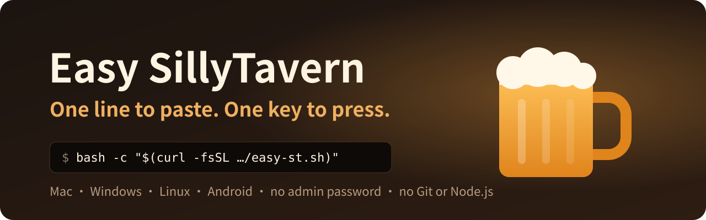
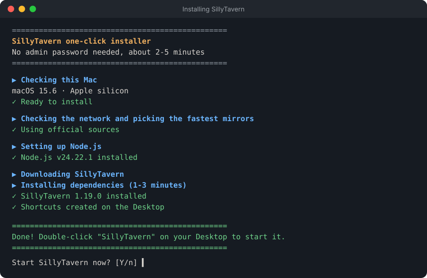

<div align="center">



<p>
  <a href="https://github.com/Horace-Maxwell/Easy-SillyTavern/actions/workflows/check.yml"></a>
  
  
  
  
  <a href="LICENSE"></a>
</p>

**A [SillyTavern](https://github.com/SillyTavern/SillyTavern) installer for people who have never used a terminal.<br>Paste one line, press Enter, and it takes care of the rest.**

[简体中文](README.md) · **English**

[Mac](#-mac) · [Windows](#-windows) · [Linux](#-linux) · [Android](#-android) · [After installing](#-after-installing) · [Troubleshooting](#-troubleshooting) · [For developers](#-for-developers)

</div>

<br>

<div align="center">

</div>

> [!IMPORTANT]
> This is an **unofficial** project and is not affiliated with the SillyTavern team. Please report installer problems [here](https://github.com/Horace-Maxwell/Easy-SillyTavern/issues), not to the official channels.

## ✨ What it does for you

| Feature | Details |
| --- | --- |
| 🧰 **Nothing else to install** | No Homebrew, Xcode, Git or Node.js, and no admin password |
| 🌏 **Picks the fastest source** | Benchmarks official sources against China mirrors (npmmirror / jsDelivr); every download is checksum-verified |
| 🛰️ **Proxy-aware** | Uses your system proxy for downloads and for SillyTavern's connections to OpenAI / Claude / Gemini; ignores a stale proxy setting left behind by a closed proxy app |
| 💻 **Knows your machine** | Mac, Windows, Linux or Android; Apple silicon or Intel, x64 or ARM, OS version — picks the matching Node.js and checks disk space first |
| 🍺 **Finds your old install** | Spots chats from an official install, a portable build or the STL launcher and offers to copy them over, leaving the originals untouched |
| 🛟 **Safe updates** | App and data live apart; every update is preceded by a backup, and a bad version rolls back in one step |
| 🩺 **Diagnostics** | Generates a report with no API keys or chat content, ready to share with whoever is helping you |

### Compared with a manual install

| | Manual install (official docs) | Easy SillyTavern |
| --- | :---: | :---: |
| Install Git and Node.js first | Yes | **No** |
| Admin password | Usually, for the prerequisites | **No** |
| Updating | `git pull` / `npm install` in a terminal | **Toolbox → 2, with automatic backup** |
| Update broke something | You're on your own | **One-step rollback** |
| Moving to a new computer | Copy the `data` folder by hand | **Backup → Restore, works across Mac and Windows** |

| Your device | Go to |
| --- | --- |
| 🍎 Mac (macOS 10.15+) | [Mac](#-mac) |
| 🪟 Windows 10 / 11 | [Windows](#-windows) |
| 🐧 Linux (Ubuntu 20.04+, Debian 10+, Fedora, Arch and others, including Steam Deck) | [Linux](#-linux) |
| 📱 Android phone | [Android](#-android) |
| iPhone, iPad | SillyTavern cannot run on these; use one of the devices above |

> Needs 1.5 GB of free space. The first install downloads about 200 MB and takes 1–5 minutes.

---

## 🍎 Mac

**1. Open Terminal**

Press `⌘ Command + Space`, type `Terminal`, press Enter.

**2. Paste this line into Terminal and press Enter**

```bash
bash -c "$(curl -fsSL -m 30 https://fastly.jsdelivr.net/gh/Horace-Maxwell/Easy-SillyTavern@main/mac/easy-st.sh || curl -fsSL -m 60 https://raw.githubusercontent.com/Horace-Maxwell/Easy-SillyTavern/main/mac/easy-st.sh)"
```

<sub>The same line works everywhere, including mainland China: it tries a CDN first and falls back to GitHub.</sub>

**3. Wait for it to finish**

- If macOS asks whether Terminal may access your Desktop (or Documents / Downloads), click **Allow**. It's looking for old chats and placing shortcuts on your Desktop. Clicking "Don't Allow" still works, you just won't get Desktop shortcuts
- If it finds existing chats, type the number shown to copy them over, or just press Enter to skip
- When it asks "Start SillyTavern now?", press Enter and your browser opens SillyTavern

> [!NOTE]
> The installer **never asks for a password**. If you see `Password:`, you pasted something else — close the window and try again.

<details>
<summary><b>Prefer not to use Terminal?</b></summary>
<br>

Click the green **Code → Download ZIP** on this page, unzip it, open the `mac` folder and double-click **双击安装酒馆** ("double-click to install").

macOS blocks it the first time: click "Done", then go to **System Settings → Privacy & Security**, scroll down, click **Open Anyway** and enter your login password (macOS asks for it, not the installer). The Terminal method skips this step.

</details>

---

## 🪟 Windows

**1. Open PowerShell**

Press `Win + R`, type `powershell`, press Enter.

**2. Paste this line and press Enter**

```powershell
powershell -NoProfile -ExecutionPolicy Bypass -Command "cd ([IO.Path]::GetTempPath()); del easy-st.ps1 -ea 0; curl.exe -fsSLo easy-st.ps1 --ssl-no-revoke -m 30 https://fastly.jsdelivr.net/gh/Horace-Maxwell/Easy-SillyTavern@main/windows/easy-st.ps1; if (!(Test-Path easy-st.ps1)) { curl.exe -fsSLo easy-st.ps1 --ssl-no-revoke -m 60 https://raw.githubusercontent.com/Horace-Maxwell/Easy-SillyTavern/main/windows/easy-st.ps1 }; powershell -NoProfile -ExecutionPolicy Bypass -File easy-st.ps1"
```

<sub>The same line works in PowerShell and Command Prompt, and everywhere including mainland China.</sub>

**3. Wait for it to finish.** When it asks "Start SillyTavern now?", press Enter.

<details>
<summary><b>Prefer not to use PowerShell?</b></summary>
<br>

Click **Code → Download ZIP**, **right-click it and choose "Extract All"**, open the `windows` folder and double-click **双击安装酒馆**.

If you see "Windows protected your PC", click **More info → Run anyway**. If your antivirus asks, choose "Allow".

</details>

---

## 🐧 Linux

Open a terminal, paste this line and press Enter. It is the same line as on Mac, and it needs no `sudo`:

```bash
bash -c "$(curl -fsSL -m 30 https://fastly.jsdelivr.net/gh/Horace-Maxwell/Easy-SillyTavern@main/mac/easy-st.sh || curl -fsSL -m 60 https://raw.githubusercontent.com/Horace-Maxwell/Easy-SillyTavern/main/mac/easy-st.sh)"
```

Afterwards, find **SillyTavern** and **SillyTavern Toolbox** in your applications menu, or run `tavern` and `tavern-tools` in a terminal.

If `curl` is missing, run `sudo apt install curl` first (`sudo dnf install curl` on Fedora, `sudo pacman -S curl` on Arch).

---

## 📱 Android

> [!NOTE]
> Android support is new. It passes the full test run in a Termux test environment, but real phones vary a lot. Please [report problems](https://github.com/Horace-Maxwell/Easy-SillyTavern/issues) so they can be fixed.

**1. Install Termux**

Termux is a free, open-source app that SillyTavern runs inside. Get it from [F-Droid](https://f-droid.org/packages/com.termux/) (tap `Download APK`) or from [GitHub](https://github.com/termux/termux-app/releases) (the apk with `universal` in its name). Avoid the Google Play version: it is an experimental build with missing features.

**2. Open Termux, paste this line and press Enter**

Long-press the black screen and tap **Paste**:

```bash
bash -c "$(curl -fsSL -m 30 https://fastly.jsdelivr.net/gh/Horace-Maxwell/Easy-SillyTavern@main/mac/easy-st.sh || curl -fsSL -m 60 https://raw.githubusercontent.com/Horace-Maxwell/Easy-SillyTavern/main/mac/easy-st.sh)"
```

A phone needs a few more downloads, usually 5–15 minutes. **Don't swipe Termux away** while it runs. Press Enter when it asks a question.

**3. Using it**

Open Termux, type `tavern` and press Enter; your browser opens SillyTavern. The toolbox is `tavern-tools`. When you're done, go back to Termux and tap `CTRL`, then `C`.

---

## 🍻 After installing

Two icons appear on your Desktop (also in the Start menu on Windows; in the applications menu on Linux; on Android use the `tavern` and `tavern-tools` commands):

| Icon | What it does |
| --- | --- |
| **SillyTavern** | Starts SillyTavern and opens your browser. Keep the console window open while you use it; close it to quit |
| **SillyTavern Toolbox** | A numbered menu, see below |

<table>
<tr><th>#</th><th>Action</th><th>#</th><th>Action</th></tr>
<tr><td align="center">1</td><td>Start SillyTavern</td><td align="center">6</td><td>Restore from a backup</td></tr>
<tr><td align="center">2</td><td>Check for updates (backs up first)</td><td align="center">7</td><td>Diagnose (creates a report on the Desktop)</td></tr>
<tr><td align="center">3</td><td>Back up data</td><td align="center">8</td><td>Roll back to the previous version</td></tr>
<tr><td align="center">4</td><td>Open the data folder</td><td align="center">9</td><td>Uninstall (backs up to the Desktop first)</td></tr>
<tr><td align="center">5</td><td>Import data from another SillyTavern</td><td align="center">0</td><td>Quit</td></tr>
</table>

### First run

**1. A welcome window appears:** pick your language, choose a name, and click **OK**.

**2. Connect an AI.** SillyTavern is only the chat interface; the replies come from an AI provider, which usually needs an API key from that provider's website.

1. Click the **plug icon 🔌** (second in the top bar)
2. Set **API** to **Chat Completion**
3. Pick your provider under **Chat Completion Source**
4. Paste your key and click **Connect** — the dot turns green
5. Tick **Auto-connect to Last Server** so you don't have to do this again

> No key yet? SillyTavern starts on AI Horde, volunteer-run compute that needs no key and costs nothing. Expect a queue and slower replies.

**3. Pick a character.** Click the **character card icon at the far right of the top bar**, choose a character (Seraphina comes built in), and type in the box at the bottom.

### Moving to a new computer

Old computer: Toolbox → **3 Back up**, then copy the backup file to the new computer's **Desktop** or **Downloads**.
New computer: install, then Toolbox → **6 Restore** and pick the file. Backups move freely between Mac, Windows, Linux and Android.

> [!WARNING]
> A backup contains your chats and API keys, so keep it to yourself. If someone is helping you, send the diagnostic report below instead.

---

## 🧯 Troubleshooting

| Problem | Fix |
| --- | --- |
| Browser didn't open | Visit the address shown in the console window, usually `http://127.0.0.1:8000` |
| Clicked "SillyTavern" twice | Harmless — it notices it's already running and just opens the page |
| Icons are gone and you can't open the toolbox | Run the install line again; on a finished install it opens the toolbox. On Windows you can also search the Start menu for SillyTavern |
| No icons on the Mac Desktop | In Finder press `⌘ Command + ⇧ Shift + H`, open **SillyTavern-Easy**; the launchers are in there |
| Can't reach OpenAI / Claude / Gemini behind a proxy | Turn on your proxy app's "system proxy", then restart SillyTavern |
| Network dropped mid-install | Paste the line again; finished parts are skipped |
| Something broke after an update | Toolbox → **8 Roll back** |
| Windows: `curl.exe` not found | Windows is too old; install updates, or use the ZIP method |
| Android: SillyTavern exits with `signal 9` | Android 12+ kills background processes. In **Settings → Developer options**, turn on "Disable child process restrictions" (the name varies by phone), and turn off battery optimization for Termux |
| Android: getting a backup out of Termux | Run `termux-setup-storage` once and allow it; backups are then also copied to your phone's Downloads folder |
| Anything else | Toolbox → **7 Diagnose**, then attach the report to an [issue](https://github.com/Horace-Maxwell/Easy-SillyTavern/issues). It contains no keys or chats |

---

## 📦 What gets installed

Everything lives in one folder; nothing system-wide is touched:

- Mac: `~/SillyTavern-Easy`
- Windows: `%LOCALAPPDATA%\SillyTavern-Easy` (deliberately not in Documents or Desktop, so OneDrive won't sync it)
- Linux and Android: `~/SillyTavern-Easy`. On Android, Node.js comes from Termux's own `pkg`

```
SillyTavern-Easy/
├── runtime/node/    private Node.js
├── app/             SillyTavern (replaced on update; app.prev is the previous version)
├── data/            chats, characters, settings (never touched by updates)
├── config.yaml      SillyTavern config
├── backups/         backups (.zip on Windows, .tar.gz elsewhere)
├── logs/            last 5 run logs
└── easy-st.sh       the toolbox itself (easy-st.ps1 on Windows)
```

## 🔧 For developers

<details>
<summary>Implementation notes, environment variables and commands</summary>
<br>

- Mac, Linux and Termux share one script, [mac/easy-st.sh](mac/easy-st.sh). It lives under `mac/` for historical reasons: installed toolboxes update from that path. On macOS it uses only what ships with the OS — bash 3.2, curl, tar, shasum, ditto
- Windows: [windows/easy-st.ps1](windows/easy-st.ps1), runs on the Windows PowerShell 5.1 that ships with Windows 10, using only the bundled curl.exe, robocopy and .NET; must be saved as UTF-8 with BOM
- SillyTavern comes from the official `sillytavern` npm package (npmjs or npmmirror, verified against `dist.integrity`), then `npm ci --ignore-scripts` with the matching `package-lock.json` from GitHub
- Node.js is verified against `SHASUMS256.txt`; macOS ≥ 13.5 gets Node 24, 11–13.4 Node 22, 10.15 Node 20; Windows 10 / 11 gets Node 24 (x64 or arm64; Node 22 on 32-bit); Linux gets Node 24 (Node 22 on 32-bit ARM) and needs glibc 2.28+; Termux uses `pkg install nodejs-lts`
- SillyTavern runs with `--configPath` / `--dataRoot`, so the app folder can be swapped wholesale
- SillyTavern's default DEBUG log records full prompts, so the installer sets it to INFO; chats stay out of the logs and the diagnostic report
- End-to-end tests: [tests/smoke.sh](tests/smoke.sh) and [tests/smoke.ps1](tests/smoke.ps1). CI runs them on macOS, Ubuntu, Termux and Windows, and runs the README's install commands verbatim
- Environment variables: `EST_HOME` (install location), `EST_LANG=zh|en`, `EST_YES=1` (no prompts), `EST_NO_START=1`, `EST_NO_BROWSER=1`, `EST_NO_SHORTCUTS=1`
- Commands: `easy-st.sh install | start | menu | update | backup | restore | import | doctor | rollback | uninstall` (Windows: `powershell -ExecutionPolicy Bypass -File easy-st.ps1 <command>`)
- Behaviour both platforms must share: [docs/DESIGN.md](docs/DESIGN.md)

</details>

Issues and PRs welcome. Read [docs/DESIGN.md](docs/DESIGN.md) before changing a script — every platform must behave the same.

## 📄 License

The scripts in this repository are [MIT](LICENSE). SillyTavern itself is AGPL-3.0 and is downloaded from official sources at install time; it is not included here.

<div align="center">
<br>
<sub>If this saved you some time, a ⭐ helps others find it.</sub>
</div>
