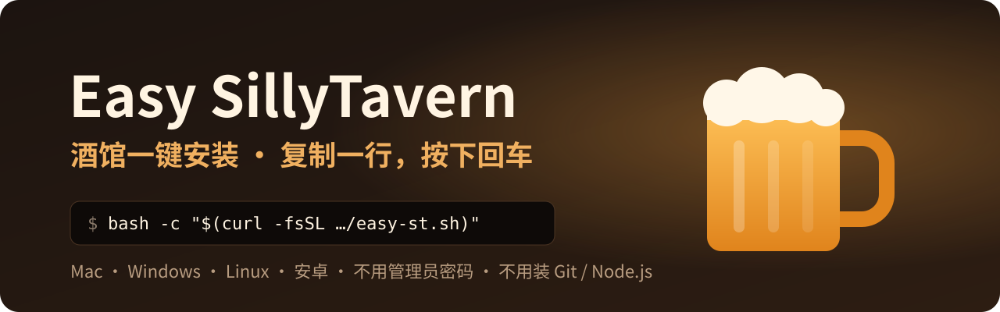
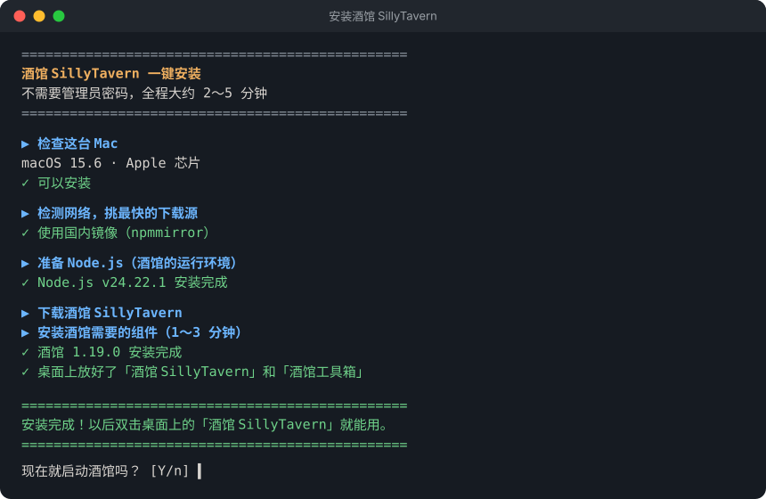

<div align="center">



<p>
  <a href="https://github.com/Horace-Maxwell/Easy-SillyTavern/actions/workflows/check.yml"></a>
  
  
  
  
  <a href="LICENSE"></a>
</p>

**给从没装过软件、不会用命令行的人准备的 [SillyTavern（酒馆）](https://github.com/SillyTavern/SillyTavern) 安装器。<br>复制一行字、按一下回车，剩下的它自己看着办。**

**简体中文** · [English](README.en.md)

[Mac](#-mac-安装) · [Windows](#-windows-安装) · [Linux](#-linux-安装) · [安卓手机](#-安卓手机安装) · [装好之后](#-装好之后) · [遇到问题](#-遇到问题) · [给懂行的人](#-给懂行的人)

</div>

<br>

<div align="center">

</div>

## ✨ 它会自己帮你做什么

| 特点 | 说明 |
| --- | --- |
| 🧰 **不用装别的** | 不需要 Homebrew、Xcode、Git、Node.js，也不要管理员密码 |
| 🌏 **自己看网络** | 自动测速，国内走 npmmirror / jsDelivr 镜像，国外走官方源；下载的文件都做校验 |
| 🛰️ **认得代理** | 开着「系统代理」时下载和连 AI 都自动走代理；代理软件关了但系统里残留着设置，也能认出来绕开 |
| 💻 **认得这台电脑** | Mac、Windows、Linux、安卓都能装；Apple 芯片 / Intel、x64 / ARM、系统版本，自动选对应的 Node.js；硬盘不够会提前说 |
| 🍺 **认得旧酒馆** | 发现官方版、免安装包、STL 启动器留下的聊天记录，问你要不要复制过来，原文件不动 |
| 🛟 **更新不丢记录** | 程序和聊天记录分开放；更新前自动备份，新版本有问题能一键退回 |
| 🩺 **出问题有报告** | 「诊断」生成一份不含密钥和聊天内容的报告，直接发给帮你的人 |

### 和自己手动装比

| | 照官方文档手动装 | Easy SillyTavern |
| --- | :---: | :---: |
| 先装 Git、Node.js | 需要 | **不用** |
| 管理员密码 | 装依赖时一般要 | **不用** |
| 国内下载慢 | 自己找镜像 | **自动测速选源** |
| 更新 | 命令行 `git pull` / `npm install` | **工具箱选 2，先自动备份** |
| 更新后出问题 | 自己想办法 | **一键退回上一版** |
| 换电脑 | 手动拷 `data` 文件夹 | **备份 → 恢复，Mac / Windows 互通** |

| 你的设备 | 看这里 |
| --- | --- |
| 🍎 Mac（macOS 10.15 以上） | [Mac 安装](#-mac-安装) |
| 🪟 Windows 10 / 11 | [Windows 安装](#-windows-安装) |
| 🐧 Linux（Ubuntu 20.04、Debian 10 以上，Fedora、Arch 等，也包括 Steam Deck） | [Linux 安装](#-linux-安装) |
| 📱 安卓手机 | [安卓手机安装](#-安卓手机安装) |
| iPhone、iPad | 酒馆跑不了，只能在上面这些设备上用 |

> 需要 1.5 GB 空闲空间，第一次安装大约下载 200 MB，一般 1～5 分钟装完。

---

## 🍎 Mac 安装

**① 打开「终端」**

按 `⌘ Command + 空格`，输入 `终端`（系统是英文的话输入 `Terminal`），按回车。会出来一个白色或黑色的窗口。

**② 复制下面这一行，粘贴进终端，按回车**

鼠标移到下面的框上，点右上角的复制按钮 📋；然后点一下终端窗口，按 `⌘ Command + V` 粘贴，再按回车。国内外都用这一行，它会自己挑连得上的地址。

```bash
bash -c "$(curl -fsSL -m 30 https://fastly.jsdelivr.net/gh/Horace-Maxwell/Easy-SillyTavern@main/mac/easy-st.sh || curl -fsSL -m 60 https://raw.githubusercontent.com/Horace-Maxwell/Easy-SillyTavern/main/mac/easy-st.sh)"
```

**③ 等它装完**

- 如果弹出「“终端”想要访问“桌面”（或“文稿”“下载”）文件夹中的文件」，点 **允许**。它是在找你以前的聊天记录，以及在桌面放图标。点了「不允许」也能装好，只是桌面上不会有图标（见[遇到问题](#-遇到问题)）
- 如果它说找到了以前的聊天记录，输入前面的编号按回车就会复制过来；不需要就直接按回车
- 最后问「现在就启动酒馆吗？」时直接按回车，浏览器会自己打开酒馆

> [!NOTE]
> 整个过程**不会让你输入密码**。如果终端里出现 `Password:`，说明粘贴的不是上面那一行，关掉窗口重来就行。

<details>
<summary><b>不想用终端？</b></summary>
<br>

在本页点绿色的 **Code → Download ZIP** 下载，解压后打开 `mac` 文件夹，双击 **双击安装酒馆**。

第一次 Mac 会拦一下：点「完成」，然后去 **系统设置 → 隐私与安全性**，往下拉，点 **仍要打开**，再输入开机密码（这是 Mac 系统要的，不是安装器要的）。用终端命令就没有这一步，所以更推荐终端。

</details>

---

## 🪟 Windows 安装

**① 打开 PowerShell**

按 `Win + R`，输入 `powershell`，按回车。会出来一个蓝色或黑色的窗口。

**② 复制下面这一行，粘贴进这个窗口，按回车**

点框右上角的复制按钮 📋，然后在窗口里按 `Ctrl + V`（或者点鼠标右键）粘贴，再按回车。国内外都用这一行，它会自己挑连得上的地址。

```powershell
powershell -NoProfile -ExecutionPolicy Bypass -Command "cd ([IO.Path]::GetTempPath()); del easy-st.ps1 -ea 0; curl.exe -fsSLo easy-st.ps1 --ssl-no-revoke -m 30 https://fastly.jsdelivr.net/gh/Horace-Maxwell/Easy-SillyTavern@main/windows/easy-st.ps1; if (!(Test-Path easy-st.ps1)) { curl.exe -fsSLo easy-st.ps1 --ssl-no-revoke -m 60 https://raw.githubusercontent.com/Horace-Maxwell/Easy-SillyTavern/main/windows/easy-st.ps1 }; powershell -NoProfile -ExecutionPolicy Bypass -File easy-st.ps1"
```

**③ 等它装完**。问「现在就启动酒馆吗？」时直接按回车，浏览器会自己打开酒馆。

<details>
<summary><b>不想用 PowerShell？</b></summary>
<br>

在本页点绿色的 **Code → Download ZIP** 下载，**先右键「全部解压缩」**，打开解压出来的 `windows` 文件夹，双击 **双击安装酒馆**。

如果提示「Windows 已保护你的电脑」：点 **更多信息** → **仍要运行**。杀毒软件拦的话选「允许」。

</details>

---

## 🐧 Linux 安装

打开终端，粘贴这一行，按回车。和 Mac 是同一行，不需要 `sudo`：

```bash
bash -c "$(curl -fsSL -m 30 https://fastly.jsdelivr.net/gh/Horace-Maxwell/Easy-SillyTavern@main/mac/easy-st.sh || curl -fsSL -m 60 https://raw.githubusercontent.com/Horace-Maxwell/Easy-SillyTavern/main/mac/easy-st.sh)"
```

装好后在应用菜单里找「酒馆 SillyTavern」和「酒馆工具箱」，或者在终端输入 `tavern`、`tavern-tools`。

如果提示找不到 `curl`，先运行 `sudo apt install curl`（Fedora 用 `sudo dnf install curl`，Arch 用 `sudo pacman -S curl`）。

---

## 📱 安卓手机安装

> [!NOTE]
> 安卓版是新加的，已经在 Termux 的测试环境里完整跑通，但真手机千差万别。遇到问题请[发到 Issues](https://github.com/Horace-Maxwell/Easy-SillyTavern/issues)，帮我们把它修好。

**① 安装 Termux**

Termux 是一个免费开源的 App，酒馆靠它在手机上运行。从 [F-Droid](https://f-droid.org/packages/com.termux/) 点 `Download APK` 下载，或者从 [GitHub](https://github.com/termux/termux-app/releases) 下载名字里带 `universal` 的 apk。不要用 Google Play 上的版本，那是实验版，少功能。

**② 打开 Termux，粘贴这一行，按回车**

手机浏览器打开这个页面，点框右上角的复制按钮 📋。然后长按 Termux 的黑色屏幕，点 **Paste** 粘贴：

```bash
bash -c "$(curl -fsSL -m 30 https://fastly.jsdelivr.net/gh/Horace-Maxwell/Easy-SillyTavern@main/mac/easy-st.sh || curl -fsSL -m 60 https://raw.githubusercontent.com/Horace-Maxwell/Easy-SillyTavern/main/mac/easy-st.sh)"
```

手机上要多装一些东西，一般 5～15 分钟。期间**别把 Termux 从后台划掉**。问你问题时直接按回车。

**③ 以后怎么用**

打开 Termux，输入 `tavern` 按回车，手机浏览器会自己打开酒馆。工具箱是 `tavern-tools`。用完回到 Termux，按屏幕下方的 `CTRL`，再按 `C`。

---

## 🍻 装好之后

桌面上会多两个图标，Mac 和 Windows 一样（Windows 的开始菜单里也有；Linux 在应用菜单里；安卓手机用 `tavern` 和 `tavern-tools` 两个命令）：

| 图标 | 干什么用 |
| --- | --- |
| **酒馆 SillyTavern** | 双击启动，浏览器会自己打开。用的时候**别关**那个黑色窗口，用完关掉它就退出了（Mac 问你时点「终止」） |
| **酒馆工具箱** | 双击后输入编号使用，见下表 |

<table>
<tr><th>编号</th><th>做什么</th><th>编号</th><th>做什么</th></tr>
<tr><td align="center">1</td><td>启动酒馆</td><td align="center">6</td><td>从备份恢复</td></tr>
<tr><td align="center">2</td><td>检查更新（会先自动备份）</td><td align="center">7</td><td>诊断（出问题时用，在桌面生成报告）</td></tr>
<tr><td align="center">3</td><td>备份聊天记录和设置</td><td align="center">8</td><td>退回上一个版本（更新后出问题时用）</td></tr>
<tr><td align="center">4</td><td>打开数据文件夹（角色卡、聊天记录在这里）</td><td align="center">9</td><td>卸载（会先把聊天记录备份到桌面）</td></tr>
<tr><td align="center">5</td><td>从别的酒馆导入聊天记录</td><td align="center">0</td><td>退出</td></tr>
</table>

### 第一次用

**① 打开后先弹出一个欢迎窗口**：选语言，起个名字，点 **确定**。

**② 连上 AI。** 酒馆只是聊天界面，回话的 AI 要另外连。一般需要一把「钥匙」（API 密钥），在 AI 服务商的网站注册、充值后创建，比如 DeepSeek 开放平台。

1. 点页面最上面一排图标里的**第 2 个（插头 🔌）**
2. 「API」选 **聊天补全**
3. 「聊天补全来源」选你的服务商，比如 **DeepSeek**
4. 把密钥粘贴进去，点 **连接**，下面的圆点变绿就好了
5. 顺手勾上「自动连接到上次的服务器」，以后打开就不用再点

> 还没有密钥也能先试试：酒馆默认连的是 AI Horde，由志愿者提供算力，不用密钥也不花钱，只是要排队，回复比较慢。

**③ 找个角色聊天。** 点页面最上面一排**最右边的角色卡图标**，选一个角色（自带一个叫 Seraphina 的），在最下面的输入框打字就行。

### 换电脑

**旧电脑**：工具箱选 **3 备份**，会弹出备份文件所在的文件夹。把这个文件拷到新电脑的**桌面**或**下载**文件夹里（微信、隔空投送、U 盘都行）。
**新电脑**：装好后在工具箱选 **6 从备份恢复**，选那个文件。Mac、Windows、Linux、安卓之间都能互相恢复。

> [!WARNING]
> 备份文件里有你的聊天记录和 API 密钥，只拷给自己，别发到群里或者发给别人。要给别人看的是下面说的「诊断报告」。

---

## 🧯 遇到问题

| 情况 | 怎么办 |
| --- | --- |
| 浏览器没自动打开 | 在浏览器地址栏输入黑色窗口里写的地址，一般是 `http://127.0.0.1:8000` |
| 又双击了一次「酒馆 SillyTavern」 | 没关系，它发现酒馆已经开着，会直接帮你打开网页 |
| 桌面图标不见了，工具箱打不开 | 再运行一次上面的安装命令，已经装好的话它会直接打开工具箱。Windows 也可以在开始菜单里搜「酒馆」 |
| Mac 桌面上没有图标 | 打开「访达」，按 `⌘ Command + ⇧ Shift + H`，进 **SillyTavern-Easy** 文件夹，里面也有「酒馆 SillyTavern」和「酒馆工具箱」。想放到桌面的话，按住 `⌥ Option + ⌘ Command` 把它拖到桌面 |
| 连不上 OpenAI / Claude / Gemini | 打开代理软件的「系统代理」，然后**重新启动酒馆**（关掉黑色窗口再双击） |
| 装到一半网断了 | 重新粘贴那一行命令，已经装好的部分会跳过 |
| 更新后酒馆出问题 | 工具箱选 **8 退回上一个版本** |
| 想用手机访问电脑上的酒馆 | 暂时不支持。安卓手机可以[直接装在手机上](#-安卓手机安装) |
| Windows：提示找不到 `curl.exe` | 系统太旧了，先装 Windows 更新，或者用上面的 ZIP 方式 |
| Windows：「Windows 已保护你的电脑」 | 点「更多信息」→「仍要运行」 |
| 手机：酒馆突然退出，显示 `signal 9` | 安卓 12 以上会杀后台进程。到**设置 → 开发者选项**，打开「停用子进程限制」（各家手机名字略有不同），再把 Termux 的电池优化关掉 |
| 手机：要把备份拿到 Termux 外面 | 运行一次 `termux-setup-storage` 并允许，以后备份时手机的「下载」文件夹里也会放一份 |
| 别的问题 | 工具箱选 **7 诊断**，把桌面上的「酒馆诊断报告」[发到 Issues](https://github.com/Horace-Maxwell/Easy-SillyTavern/issues)，或者发给帮你的人。报告里没有你的密钥和聊天内容 |

> [!IMPORTANT]
> 这是**非官方**项目，和 SillyTavern 开发团队没有关系。安装器的问题请到[本仓库的 Issues](https://github.com/Horace-Maxwell/Easy-SillyTavern/issues) 反馈，不要去打扰官方。

---

## 📦 装了哪些东西

全部在一个文件夹里，不碰系统：

- Mac：`~/SillyTavern-Easy`（在「访达」里按 `⌘⇧H` 就能看到）
- Windows：`%LOCALAPPDATA%\SillyTavern-Easy`，一般是 `C:\Users\你的用户名\AppData\Local\SillyTavern-Easy`。故意不放「文档」「桌面」，免得被 OneDrive 同步
- Linux、安卓：`~/SillyTavern-Easy`。安卓上的 Node.js 由 Termux 自己的 `pkg` 安装

```
SillyTavern-Easy/
├── runtime/node/    私有的 Node.js
├── app/             酒馆程序（更新时整个换掉；app.prev 是上一个版本）
├── data/            聊天记录、角色卡、设置（更新时不动）
├── config.yaml      酒馆配置
├── backups/         备份（Windows 是 .zip，其他是 .tar.gz）
├── logs/            运行记录（最近 5 次）
└── easy-st.sh       工具箱本体（Windows 是 easy-st.ps1）
```

卸载：工具箱选 **9 卸载**，它会先把聊天记录备份到桌面再删（桌面放不了就放用户文件夹）。

## 🔧 给懂行的人

<details>
<summary>实现细节、环境变量和命令</summary>
<br>

- Mac、Linux、Termux 共用一个脚本：[mac/easy-st.sh](mac/easy-st.sh)。放在 `mac/` 下是历史原因，已经装好的工具箱都从这个路径更新。Mac 上只用系统自带的 bash 3.2 / curl / tar / shasum / ditto
- Windows 脚本：[windows/easy-st.ps1](windows/easy-st.ps1)，兼容 Win10 自带的 Windows PowerShell 5.1，只用系统自带的 curl.exe / robocopy 和 .NET；文件必须是带 BOM 的 UTF-8
- 酒馆从 npm 上的官方 `sillytavern` 包下载（npmjs 或 npmmirror，用 `dist.integrity` 校验），再从 GitHub 拿同版本的 `package-lock.json` 跑 `npm ci --ignore-scripts`
- Node.js 用 `SHASUMS256.txt` 校验；macOS ≥ 13.5 用 Node 24，11～13.4 用 Node 22，10.15 用 Node 20；Windows 10 / 11 用 Node 24（x64 或 arm64，32 位系统用 22）；Linux 用 Node 24（32 位 ARM 用 22），要 glibc 2.28 以上；Termux 用 `pkg install nodejs-lts`
- 酒馆用 `--configPath` / `--dataRoot` 启动，程序目录可以整个替换
- 酒馆默认的 DEBUG 日志会写下完整聊天内容，这里改成 INFO，运行记录和诊断报告里都不会有
- 端到端测试：[tests/smoke.sh](tests/smoke.sh)、[tests/smoke.ps1](tests/smoke.ps1)，CI 在 macOS、Ubuntu、Termux、Windows 上都跑，README 里的安装命令也会原样跑一遍
- 常用环境变量：`EST_HOME`（安装位置）、`EST_LANG=zh|en`、`EST_YES=1`（不问问题）、`EST_NO_START=1`、`EST_NO_BROWSER=1`、`EST_NO_SHORTCUTS=1`
- 命令：`easy-st.sh install | start | menu | update | backup | restore | import | doctor | rollback | uninstall`（Windows：`powershell -ExecutionPolicy Bypass -File easy-st.ps1 <命令>`）
- 两边要对齐的行为：[docs/DESIGN.md](docs/DESIGN.md)

</details>

**想帮忙？** 欢迎提 Issue 和 PR。改脚本前先看一眼 [docs/DESIGN.md](docs/DESIGN.md)，各个系统上的行为要保持一致。

## 📄 许可

本仓库的脚本使用 [MIT](LICENSE) 许可。SillyTavern 本身是 AGPL-3.0，安装时从官方渠道下载，不在本仓库里。

<div align="center">
<br>
<sub>觉得好用的话，点右上角 ⭐ Star，让更多人找到它。</sub>
</div>
